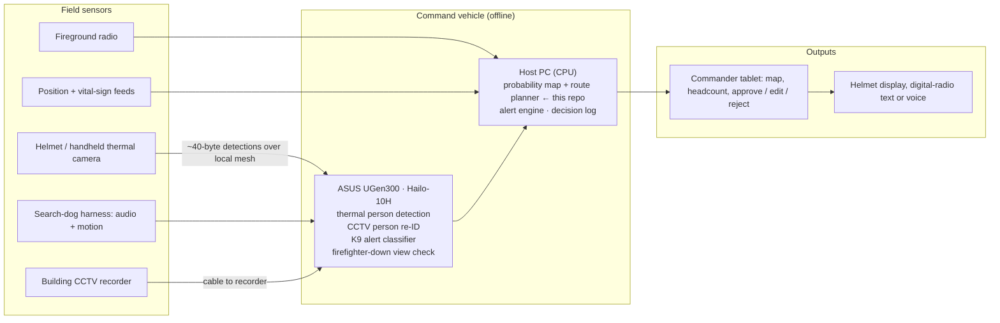

# LastSeen — offline victim localization for smoke-filled rescue

LastSeen helps an incident commander answer one question faster: **where are the people still trapped inside?**
It fuses pre-smoke CCTV ("where was each person last seen, and which way were they walking?"),
search-dog alerts and helmet thermal cameras into one live probability map, and proposes a search
order for each crew. The commander approves, edits or rejects every route. Everything is designed to
run offline on an **ASUS UGen300** (Hailo-10H) in the command vehicle.

Entry for the **ASUS UGen AI League 2026 — Battlefield Lightning (Workplace AI)**.

> **Status (Stage I, October 2026):** this repository contains the working **search simulator**:
> building model, scenario generator, probability map, route planner and a reproducible benchmark.
> The vision models that will feed the map (thermal detection, CCTV re-identification, dog-alert
> classifier) are **planned for Stage II** and are described in [docs/model_plan.md](docs/model_plan.md).
> All results below are **simulation results, not field data.**

---

## Results at a glance

1,000 simulated fires, one search crew (two firefighters and a dog), 2–5 trapped people per fire.

| | First victim found (mean) | Each victim found (mean) | All victims found (median) |
|---|---:|---:|---:|
| Current practice (nearest room first) | 231 s | 487 s | 736 s |
| **LastSeen** | **124 s** | **325 s** | **512 s** |
| **Improvement** | **46% faster** (95% CI 43–49%) | **33% faster** (95% CI 31–35%) | **30% faster** |

- LastSeen reached the first victim sooner in 624 of 1,000 fires, at the same time in 192 and later in 184.
- **Buildings without CCTV:** the planner still helps (first victim 26% faster), because it fuses dog alerts
  and re-checks likely rooms instead of sweeping in a fixed order.
- **Where the gain comes from:** people a camera saw before the smoke are found in 271 s instead of 484 s.
  People no camera saw: 402 s instead of 490 s.


Full tables: [results/summary.md](results/summary.md) · per-fire data: [results/per_scenario.csv](results/per_scenario.csv) ·
robustness: [results/sensitivity.md](results/sensitivity.md)

### One example fire


*Scenario 7, chosen because it shows the mechanism clearly; across all fires LastSeen is sometimes slower
(see the counts above).* Current practice starts at the nearest rooms and reaches the first person after
416 s. LastSeen starts from the CCTV last-seen tracks (arrows) and searches the most likely room first (80 s).

---

## Quick start

Requires Python 3.10 or newer. The simulator uses only the standard library; charts need matplotlib.

```bash
git clone https://github.com/tiggerpei123/lastseen-rescue.git
cd lastseen-rescue
pip install -r requirements.txt

python tests/test_sim.py                  # basic checks
python run_benchmark.py                   # 1,000 fires → results/summary.md, chart, CSV (about 10 s)
python run_benchmark.py --scenarios 30    # a quick run
python run_example.py --seed 7            # draws results/example_map.png
python run_sensitivity.py                 # robustness → results/sensitivity.md
```

Every run is deterministic: the same seeds give the same numbers.

---

## System architecture (target system)



The code in `lastseen_sim/probability_map.py` and the `lastseen` planner in `lastseen_sim/simulate.py`
are the parts that will run on the host PC. In this repository their inputs come from the simulator;
in Stage II they come from the models running on the UGen300. More detail: [docs/architecture.md](docs/architecture.md).

---

## How the simulation works

**Building.** One floor, a straight corridor with 8 rooms on each side (rooms 201–216). The crew enters
at one end. Moving in smoke: 0.5 m/s. Searching a room: 40 s.

**Trapped people.** 2–5 per fire, each in a random room. 60% of them walked past a corridor camera
before the smoke. For those, the simulator records a noisy last-seen position and walking direction
(direction read wrongly 15% of the time). The camera cannot see which side of the corridor they entered.

**Sensors.** A room search finds a person who is there 85% of the time (so a second search can be needed).
The dog alerts at 60% of occupied doors it passes and falsely at 5% of empty ones.

**Strategies compared.**

| Strategy | What it does |
|---|---|
| Current practice | Search the nearest room not yet searched; when all are done, sweep again. |
| Current practice + dog | Same, but go straight to any room where the dog alerted. |
| **LastSeen** | Keep a probability for every room (CCTV prior, then updated by every search and dog pass) and go where *probability ÷ time to get there and search* is highest. |
| LastSeen, no CCTV | The same planner when the building has no cameras. |

**Fairness.** All strategies face the same fires and the same sensor luck: each sensor outcome comes from
a random stream keyed by fire, sensor, room or person, and visit number. A search stops when everyone
is found or after 20 minutes; anyone not found counts as 20 minutes.

All assumptions are in one file, [lastseen_sim/config.py](lastseen_sim/config.py).

### Does the result depend on our assumptions?

[results/sensitivity.md](results/sensitivity.md) changes one assumption at a time (500 fires each).
LastSeen stays faster to the first victim in every setting tested, from **26%** (no CCTV at all, or a
small 8-room floor) to **55%** (a 24-room floor). The gain grows with CCTV coverage and building size.

---

## Limitations (what this simulation does not show)

- It is a **simplified model**, not a fire. No fire spread, heat, collapse, doors, stairs or multiple floors.
- **Sensor performance is assumed**, not measured. Stage II will measure the real models on the UGen300.
- "Current practice" is modelled as a systematic nearest-room-first search. Real crews also use
  bystander reports and experience, so the real gap may be smaller.
- The simulation stops when everyone is found. In practice the crew still completes the full search;
  LastSeen only changes the **order** in which rooms are searched, and the commander approves every route.
- Times are relative comparisons between strategies, not predictions of real rescue times.

## Privacy

No real CCTV footage or personal data is used in this repository. Stage II uses public datasets and
recorded drills only. In deployment, footage stays on the vehicle node and is deleted after the incident,
subject to a review under Taiwan's Personal Data Protection Act.

## Repository layout

```
lastseen_sim/
  config.py            all assumptions in one place
  building.py          corridor-and-rooms floor model
  scenario.py          random fires: trapped people and CCTV last-seen tracks
  probability_map.py   LastSeen map: CCTV prior + Bayesian updates from searches and dog passes
  simulate.py          search loop and the four strategies
  metrics.py           results, summaries, bootstrap confidence intervals
run_benchmark.py       main benchmark → results/
run_sensitivity.py     one-assumption-at-a-time robustness check
run_example.py         draws one scenario
plots.py               charts
tests/test_sim.py      basic checks
docs/                  architecture, model plan, Stage II plan
results/               generated outputs (committed so judges can read them without running code)
```

## Roadmap

Stage II (6 Nov – 4 Dec 2026): models on the UGen300, live map from real sensors, commander approval flow,
alerts, and a test with every network switched off. See [docs/stage2_plan.md](docs/stage2_plan.md).

## Team

LastSeen team — 獨孤魚 · 駱沛妤 (Sophie Lo). Contact: sophiepeiylo@gmail.com.

## License

© 2026 LastSeen team. All rights reserved. Shared for evaluation in the ASUS UGen AI League 2026.
